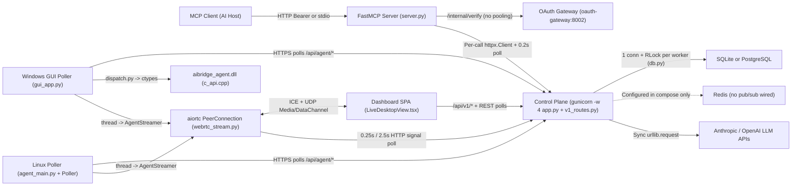
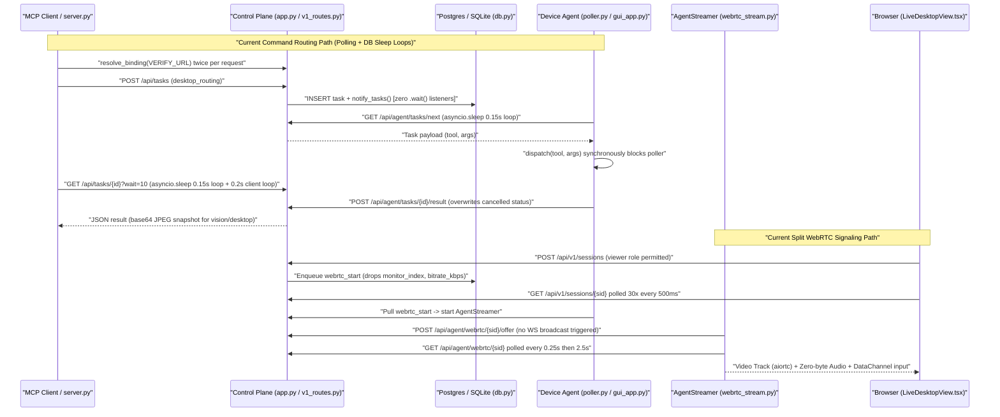
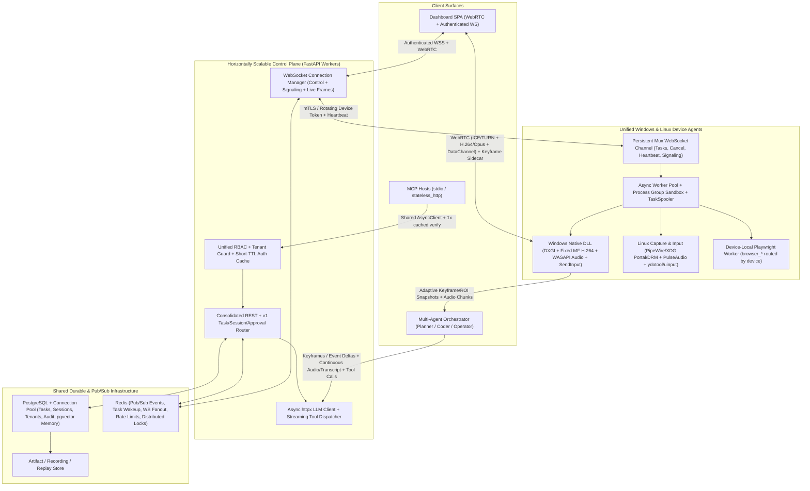

# ServerAI (`ai-bridge` v0.3.0) Technical Audit & Advanced Platform Roadmap

> **Audit Scope & Method**: Strictly read-only inspection of source files, manifests, native C++ agent code, React/TypeScript dashboard sources, Docker/CI definitions, and configuration templates in `c:\Users\Administrator\Documents\serverAI` against `ai-bridge` v0.3.0. No secrets or `.env` files were read, no packages were installed, no code was mutated, and no project services were executed. Every cited symbol, path, and line number reflects direct source inspection.

---

## Executive Summary

The repository already contains a substantial multi-surface foundation: a Python FastMCP server ([`server.py`](file:///c:/Users/Administrator/Documents/serverAI/src/ai_bridge/server.py)), a FastAPI control plane ([`app.py`](file:///c:/Users/Administrator/Documents/serverAI/src/ai_bridge/control/app.py) + [`v1_routes.py`](file:///c:/Users/Administrator/Documents/serverAI/src/ai_bridge/control/v1_routes.py)), autonomous/scheduled agent execution ([`ai_api.py`](file:///c:/Users/Administrator/Documents/serverAI/src/ai_bridge/control/ai_api.py) + [`custom_agents.py`](file:///c:/Users/Administrator/Documents/serverAI/src/ai_bridge/control/custom_agents.py)), cross-OS polling agents ([`poller.py`](file:///c:/Users/Administrator/Documents/serverAI/agents/common/poller.py), [`agent_main.py`](file:///c:/Users/Administrator/Documents/serverAI/agents/linux/agent_main.py), [`gui_app.py`](file:///c:/Users/Administrator/Documents/serverAI/agents/windows/gui_app.py)), a native C++ DXGI/`SendInput`/MediaFoundation DLL ([`c_api.cpp`](file:///c:/Users/Administrator/Documents/serverAI/windows-agent/src/c_api.cpp)), an `aiortc` desktop WebRTC streamer ([`webrtc_stream.py`](file:///c:/Users/Administrator/Documents/serverAI/src/ai_bridge/webrtc_stream.py)), and a React live-desktop dashboard ([`LiveDesktopView.tsx`](file:///c:/Users/Administrator/Documents/serverAI/apps/dashboard/src/views/LiveDesktopView.tsx)).

However, end-to-end call-path tracing exposes **structural gaps** between the marketed capabilities and actual production behavior:

1. **No continuous WebRTC/video/audio pipeline reaches AI clients**: [`AgentStreamer`](file:///c:/Users/Administrator/Documents/serverAI/src/ai_bridge/webrtc_stream.py#L883-L1049) streams video only to human browser viewers; [`DesktopAudioTrack`](file:///c:/Users/Administrator/Documents/serverAI/src/ai_bridge/webrtc_stream.py#L310-L355) emits 100% zeroed silence bytes; AI callers (MCP and [`ai_api.py`](file:///c:/Users/Administrator/Documents/serverAI/src/ai_bridge/control/ai_api.py)) only see discrete one-shot JPEG screenshots (`q=72`).
2. **Broken WebRTC signaling convergence & multi-worker state split**: [`LiveDesktopView.tsx`](file:///c:/Users/Administrator/Documents/serverAI/apps/dashboard/src/views/LiveDesktopView.tsx#L1102-L1145) uses `/api/v1/sessions`, whereas [`_start_webrtc_from_task`](file:///c:/Users/Administrator/Documents/serverAI/src/ai_bridge/control/dispatch.py#L14-L26) spawns `HttpSignaling` against `/api/agent/webrtc/*` in [`app.py`](file:///c:/Users/Administrator/Documents/serverAI/src/ai_bridge/control/app.py#L3142-L3181), which persists DB state but never triggers [`_broadcast_ws`](file:///c:/Users/Administrator/Documents/serverAI/src/ai_bridge/control/v1_routes.py#L217-L225). Combined with `gunicorn -w 4` ([`Dockerfile.prod`](file:///c:/Users/Administrator/Documents/serverAI/deployment/docker/Dockerfile.prod#L64)) and in-memory maps (`_HUMAN_TAKEOVER_BY_DEVICE`, `ws_subscribers`, `_APPROVALS`, `_SELECTED_DEVICE`), state diverges across workers while browsers and agents fall back to polling loops.
3. **Severe RBAC, policy, and isolation holes in Control Plane & v1 routes**: Several mutating `/api/v1/sessions*` routes only check `auth_context(...)` without `require_role(...)`; signaling routes allow `"viewer"`; WebSocket `/api/v1/ws/sessions/{session_id}` accepts connections with zero authentication; `POST /api/v1/tasks` skips policy checks and approval gating; `v1_session_clipboard` operates on the Control Plane host clipboard instead of the target device; and [`execute_ai_tool`](file:///c:/Users/Administrator/Documents/serverAI/src/ai_bridge/control/ai_api.py#L1230-L1242) runs host `dispatch()` without checking `AI_BRIDGE_DISABLE_HOST_TOOLS`.
4. **Polling-bound latency & blocking I/O throughout the stack**: [`task_cond`](file:///c:/Users/Administrator/Documents/serverAI/src/ai_bridge/control/app.py#L624-L629) is never `.wait()`ed upon, leaving 150ms–200ms sleep-poll loops on server and MCP router; `httpx.Client` is recreated on every routed call; `ai_api.py` and `custom_agents.py` run blocking `urllib.request.urlopen` calls; [`PostgresConnection`](file:///c:/Users/Administrator/Documents/serverAI/src/ai_bridge/control/db.py#L298-L368) serializes all queries behind a single connection and `RLock`; and desktop OCR spawns cold `powershell.exe` processes per call ([`vision.py`](file:///c:/Users/Administrator/Documents/serverAI/src/ai_bridge/vision.py#L120-L151)).

---

## 1. Current Architecture & Verified Call Flows

### 1.1 Component Topology

### 1.2 Verified Task & WebRTC Signaling Flows

---

## 2. Repository Map & Key Entry Points

| Layer | Path | Key Entry Points / Symbols | Verified Role |
| :--- | :--- | :--- | :--- |
| Packaging & CLI | [`pyproject.toml`](file:///c:/Users/Administrator/Documents/serverAI/pyproject.toml#L1-L49) | `ai_bridge.server:main`, `ai_bridge.control.__main__:main` | Package manifest (`v0.3.0`), scripts, ruff/pytest metadata. |
| Production Compose | [`docker-compose.prod.yml`](file:///c:/Users/Administrator/Documents/serverAI/docker-compose.prod.yml#L1-L100) | Services `control-api`, `mcp-http`, `oauth-gateway`, Postgres, Redis | Multi-service container topology (`:8000`, `:8001`, `:8002`). |
| Container Build | [`Dockerfile.prod`](file:///c:/Users/Administrator/Documents/serverAI/deployment/docker/Dockerfile.prod#L1-L64) | `gunicorn -w 4 -k uvicorn.workers.UvicornWorker ... create_app()` | Multi-stage Node 22 + Python 3.12 image; installs `psycopg[binary]`. |
| CI Pipeline | [`ci.yml`](file:///c:/Users/Administrator/Documents/serverAI/.github/workflows/ci.yml#L1-L36) | Jobs `test`, `dashboard` | Ubuntu Python `ruff`+`pytest` and Node 20 dashboard/Playwright checks. |
| Config Template | [`.env.example`](file:///c:/Users/Administrator/Documents/serverAI/.env.example#L1-L22) | `AI_BRIDGE_*` env template | Safe sample env vars (omits Compose/prod DB/Redis/Gateway vars). |
| MCP Server | [`server.py`](file:///c:/Users/Administrator/Documents/serverAI/src/ai_bridge/server.py) | `create_http_app`, `main`, `device_aware`, `_BearerAuthMiddleware` | FastMCP server (`stateless_http=True`), host/device tools, 16 `browser_*` tools. |
| MCP Device Router | [`device_routing.py`](file:///c:/Users/Administrator/Documents/serverAI/src/ai_bridge/device_routing.py#L1-L117) | `resolve_binding`, `run_device_tool`, `get_device_task`, `cancel_device_task` | HTTP client helpers bridging MCP server to OAuth gateway and Control Plane. |
| Local Runner | [`execution.py`](file:///c:/Users/Administrator/Documents/serverAI/src/ai_bridge/execution.py#L1-L213) | `TASK_REGISTRY`, `TaskRunner`, `RUNNER` | Local allowlisted subprocess runner with `rlimit`, `unshare`, and process-group kill. |
| Host & Desktop Tools | [`tools.py`](file:///c:/Users/Administrator/Documents/serverAI/src/ai_bridge/tools.py) | `click_element`, `set_of_marks_screenshot`, `run_shell`, `terminal_exec`, `read_file` | Local OS/desktop automation, DPI awareness, Screen grab, JPEG encoding. |
| Desktop Vision & SoM | [`vision.py`](file:///c:/Users/Administrator/Documents/serverAI/src/ai_bridge/vision.py#L115-L424) | `run_ocr`, `list_win32_ui_controls`, `find_text_coordinates`, `generate_set_of_marks` | Cold PowerShell OCR, Win32 UI enumeration, SoM bounding-box overlay & `mark_map`. |
| WebRTC Streamer | [`webrtc_stream.py`](file:///c:/Users/Administrator/Documents/serverAI/src/ai_bridge/webrtc_stream.py#L185-L1084) | `ScreenTrack`, `DesktopAudioTrack`, `HttpSignaling`, `AgentStreamer`, `start_stream` | `aiortc` video/silent-audio/DataChannel agent streamer + HTTP signaling poller. |
| Control Plane Core | [`app.py`](file:///c:/Users/Administrator/Documents/serverAI/src/ai_bridge/control/app.py) | `create_app`, `auth_context`, `require_role`, `submit_task`, `next_task`, `task_result` | Core REST API, tenant policy/approvals, legacy WebRTC signaling, agent endpoints. |
| Control Plane v1 API | [`v1_routes.py`](file:///c:/Users/Administrator/Documents/serverAI/src/ai_bridge/control/v1_routes.py#L1-L950) | `attach_v1_routes`, `v1_create_session`, `v1_session_websocket`, `v1_create_task` | v1 device/session/task REST routes and WebSocket signaling endpoint. |
| AI & Tool Orchestrator | [`ai_api.py`](file:///c:/Users/Administrator/Documents/serverAI/src/ai_bridge/control/ai_api.py#L1-L2137) | `execute_ai_tool`, `run_autonomous_agent`, `validate_llm_key`, `/api/ai/chat*` | Direct AI tool execution (`is_local` dispatch), multi-step tool loop, LLM proxy. |
| Scheduled Agents | [`custom_agents.py`](file:///c:/Users/Administrator/Documents/serverAI/src/ai_bridge/control/custom_agents.py#L1-L1257) | `execute_agent`, `AgentRunner`, `install_custom_agent_routes` | Scheduled background agents (`5s` tick, `MAX_CONCURRENT_RUNS=2`) + `/api/agents*`. |
| Agent Dispatch | [`dispatch.py`](file:///c:/Users/Administrator/Documents/serverAI/src/ai_bridge/control/dispatch.py#L1-L314) | `_start_webrtc_from_task`, `dispatch` | Agent-side tool dispatcher translating queued task names to local tool/stream calls. |
| Database Abstraction | [`db.py`](file:///c:/Users/Administrator/Documents/serverAI/src/ai_bridge/control/db.py#L145-L417) | `to_pg_sql`, `LockedConnection`, `PostgresConnection`, `connect` | SQLite / single-connection PostgreSQL wrapper guarded by `threading.RLock`. |
| Database Backup | [`backup.py`](file:///c:/Users/Administrator/Documents/serverAI/src/ai_bridge/control/backup.py#L1-L48) | `verified_backup` | SQLite-only `sqlite3.Connection.backup()` helper. |
| Agent Common Poller | [`poller.py`](file:///c:/Users/Administrator/Documents/serverAI/agents/common/poller.py#L138-L309) | `Poller.heartbeat`, `Poller.run_once`, `Poller.run_forever` | Synchronous agent poll/execute/report loop with `TaskSpooler`. |
| Linux Device Agent | [`agent_main.py`](file:///c:/Users/Administrator/Documents/serverAI/agents/linux/agent_main.py#L250-L1052) | `gather_linux_telemetry`, `run_doctor`, `enroll_cmd`, `update_cmd`, `run_agent_loop` | Linux daemon CLI, telemetry, service management, git-reset updater, `Poller` host. |
| Windows GUI Agent | [`gui_app.py`](file:///c:/Users/Administrator/Documents/serverAI/agents/windows/gui_app.py#L1570-L1710) | `_poll_loop` | Desktop GUI wrapper implementing its own direct `poller._req()` polling loop. |
| Native C++ C API | [`c_api.cpp`](file:///c:/Users/Administrator/Documents/serverAI/windows-agent/src/c_api.cpp#L1-L249) | `aibridge_capture_*`, `aibridge_encode_h264_frame`, `aibridge_input_*` | Native DXGI capture, MF H.264 encode, and `SendInput` DLL exports. |
| Native H.264 Encoder | [`mf_h264_encoder.cpp`](file:///c:/Users/Administrator/Documents/serverAI/windows-agent/src/encoder/mf_h264_encoder.cpp#L110-L430) | `MfH264Encoder` | Windows MediaFoundation H.264 encoder with broken frame-0 fallback path. |
| Native Transport Stub | [`webrtc_transport.cpp`](file:///c:/Users/Administrator/Documents/serverAI/windows-agent/src/webrtc/webrtc_transport.cpp#L1-L112) | `WebRtcTransport` | Local capture+encode+input harness without ICE, DTLS, or RTP sockets. |
| Native MCP Stub | [`mcp_executor.cpp`](file:///c:/Users/Administrator/Documents/serverAI/windows-agent/src/mcp/mcp_executor.cpp#L1-L93) | `McpExecutor` | Partial C++ executor implementing only `GetVisibleWindows` & `LaunchApprovedApplication`. |
| Dashboard Live View | [`LiveDesktopView.tsx`](file:///c:/Users/Administrator/Documents/serverAI/apps/dashboard/src/views/LiveDesktopView.tsx#L1100-L1200) | `handleStartWebrtc` | Browser WebRTC UI calling `/api/v1/sessions` with 500ms REST polling fallback. |

---

## 3. Feature Inventory (`Implemented` / `Partial` / `Missing`)

| Domain / Capability | Status | Evidence & Verified Behavior |
| :--- | :--- | :--- |
| FastMCP server & OAuth Bearer middleware | **Implemented** | [`server.py`](file:///c:/Users/Administrator/Documents/serverAI/src/ai_bridge/server.py#L1468-L1553) exposes `create_http_app` and `_BearerAuthMiddleware` verifying tokens via `resolve_binding`. |
| Device routing decorator for desktop MCP tools | **Partial** | [`device_aware`](file:///c:/Users/Administrator/Documents/serverAI/src/ai_bridge/server.py#L267-L345) routes `DESKTOP_ROUTING_TOOLS` via [`device_routing.py`](file:///c:/Users/Administrator/Documents/serverAI/src/ai_bridge/device_routing.py#L62-L89), but omits `browser_*` tools and stores `_APPROVALS`/`_SELECTED_DEVICE` only in process RAM. |
| Cross-device Playwright browser automation | **Partial** | 16 `browser_*` tools exist in [`server.py`](file:///c:/Users/Administrator/Documents/serverAI/src/ai_bridge/server.py#L1330-L1465), but none accept `device` or `@device_aware`, and [`dispatch.py`](file:///c:/Users/Administrator/Documents/serverAI/src/ai_bridge/control/dispatch.py#L1-L314) has zero `browser_*` handlers. All browser automation runs exclusively on the MCP host. |
| Local allowlisted command execution | **Implemented** | [`TaskRunner`](file:///c:/Users/Administrator/Documents/serverAI/src/ai_bridge/execution.py#L1-L213) enforces allowlists, `rlimit`, optional `AI_BRIDGE_TASK_NETNS=1` (`unshare`), and process-group kill (`taskkill /F /T` / `os.killpg`). [`run_shell`](file:///c:/Users/Administrator/Documents/serverAI/src/ai_bridge/tools.py#L1222-L1242) splits argv with `shell=False`. |
| Windows DXGI capture & `SendInput` via C++ DLL | **Implemented** | [`c_api.cpp`](file:///c:/Users/Administrator/Documents/serverAI/windows-agent/src/c_api.cpp#L1-L249) exports capture and input functions consumed by [`grab_screen`](file:///c:/Users/Administrator/Documents/serverAI/src/ai_bridge/webrtc_stream.py#L185-L206) and [`_handle_input_payload`](file:///c:/Users/Administrator/Documents/serverAI/src/ai_bridge/webrtc_stream.py#L799-L872). |
| Hardware H.264 WebRTC transport (Windows C++) | **Partial** | [`aibridge_encode_h264_frame`](file:///c:/Users/Administrator/Documents/serverAI/windows-agent/src/c_api.cpp#L141-L193) exists in DLL but is never called by [`webrtc_stream.py`](file:///c:/Users/Administrator/Documents/serverAI/src/ai_bridge/webrtc_stream.py); [`mf_h264_encoder.cpp`](file:///c:/Users/Administrator/Documents/serverAI/windows-agent/src/encoder/mf_h264_encoder.cpp#L383-L403) emits corrupt fake frames on MFT frame-0 miss; [`webrtc_transport.cpp`](file:///c:/Users/Administrator/Documents/serverAI/windows-agent/src/webrtc/webrtc_transport.cpp#L1-L112) lacks ICE/DTLS/RTP networking. |
| Human-facing desktop WebRTC video & DataChannel control | **Partial** | [`AgentStreamer`](file:///c:/Users/Administrator/Documents/serverAI/src/ai_bridge/webrtc_stream.py#L883-L1049) streams video via `aiortc` (`av.VideoFrame.from_image`), switches monitors on DataChannel, transfers files, and relays keyboard/mouse/clipboard, but drops initial `monitor_index`/`bitrate_kbps` in [`_start_webrtc_from_task`](file:///c:/Users/Administrator/Documents/serverAI/src/ai_bridge/control/dispatch.py#L21-L26) and splits signaling across `/api/v1/sessions` and `/api/agent/webrtc/*`. |
| Real desktop audio streaming | **Missing** | [`DesktopAudioTrack`](file:///c:/Users/Administrator/Documents/serverAI/src/ai_bridge/webrtc_stream.py#L310-L355) synthesizes silent zero bytes (`_silent_bytes` at L328, L352). No WASAPI or PulseAudio/PipeWire capture exists. |
| Continuous frame/audio feed to AI clients (multimodal stream) | **Missing** | Neither MCP (`server.py`) nor [`ai_api.py`](file:///c:/Users/Administrator/Documents/serverAI/src/ai_bridge/control/ai_api.py) consumes WebRTC media or pushes continuous frames/audio to an LLM/AI client; AI receives discrete one-shot JPEG screenshots per tool call (`_extract_image` at L540). |
| OCR & Set-of-Marks (SoM) UI grounding | **Partial** | [`generate_set_of_marks`](file:///c:/Users/Administrator/Documents/serverAI/src/ai_bridge/vision.py#L336-L424) builds `mark_map[mark_id]` with bounding-box centers, and [`run_ocr`](file:///c:/Users/Administrator/Documents/serverAI/src/ai_bridge/vision.py#L120-L151) performs OCR by spawning cold PowerShell per call. However, [`click_element(mark_id=...)`](file:///c:/Users/Administrator/Documents/serverAI/src/ai_bridge/tools.py#L909-L912) ignores `mark_map` coordinates and calls `click_text(str(mark_id))` to OCR-search literal digit text. |
| Multi-tenant Control Plane RBAC & approvals | **Partial** | Role checks and tenant policies exist in [`app.py`](file:///c:/Users/Administrator/Documents/serverAI/src/ai_bridge/control/app.py#L651-L800), but [`v1_routes.py`](file:///c:/Users/Administrator/Documents/serverAI/src/ai_bridge/control/v1_routes.py#L512-L950) bypasses `require_role`, accepts unauthenticated WS upgrades, and bypasses device policy & Tier 3/4 approval checks on `/api/v1/tasks`; [`app.py`](file:///c:/Users/Administrator/Documents/serverAI/src/ai_bridge/control/app.py#L1442-L1586) omits tenant filters on task cancellation and approval endpoints. |
| Autonomous multi-step AI loop & scheduled agents | **Partial** | [`run_autonomous_agent`](file:///c:/Users/Administrator/Documents/serverAI/src/ai_bridge/control/ai_api.py#L1370-L1734) and [`AgentRunner`](file:///c:/Users/Administrator/Documents/serverAI/src/ai_bridge/control/custom_agents.py#L681-L919) work on single processes, but block async loops with synchronous `urllib.request.urlopen`, hardcode `tenant="default"` in agent creation, lack multi-agent DAG/handoff orchestration, and have no cross-run vector/episodic memory. |
| Cooperative agent task cancellation & push wakeups | **Partial** | [`cancel_task`](file:///c:/Users/Administrator/Documents/serverAI/src/ai_bridge/control/app.py#L1442-L1454) sets DB `status='cancelled'`, but there is no push signal to agents, running tasks are synchronous in [`Poller.run_once`](file:///c:/Users/Administrator/Documents/serverAI/agents/common/poller.py#L258-L293), and [`task_result`](file:///c:/Users/Administrator/Documents/serverAI/src/ai_bridge/control/app.py#L4013-L4014) blindly overwrites `cancelled` with agent completion status. |
| Horizontal scale & Redis pub/sub coordination | **Missing** | `redis>=5.0` is declared in [`pyproject.toml`](file:///c:/Users/Administrator/Documents/serverAI/pyproject.toml#L20) and Redis runs in [`docker-compose.prod.yml`](file:///c:/Users/Administrator/Documents/serverAI/docker-compose.prod.yml), yet `ws_subscribers`, `_HUMAN_TAKEOVER_BY_DEVICE`, `_APPROVALS`, and `_SELECTED_DEVICE` remain process-local under `gunicorn -w 4`, and Postgres uses a single unpooled connection behind `RLock`. |
| PostgreSQL backup/recovery & Windows CI validation | **Missing** | [`backup.py`](file:///c:/Users/Administrator/Documents/serverAI/src/ai_bridge/control/backup.py#L1-L48) is SQLite-only; [`ci.yml`](file:///c:/Users/Administrator/Documents/serverAI/.github/workflows/ci.yml#L1-L36) has zero `windows-latest` jobs, zero MSVC/CMake build tests, and zero Postgres/Redis integration tests; `psycopg[binary]` is omitted from [`pyproject.toml`](file:///c:/Users/Administrator/Documents/serverAI/pyproject.toml#L11-L21). |

---

## 4. Concrete Bottlenecks, Security Vulnerabilities & Reliability Risks

### 4.1 Security & Authorization Risks (P0 Immediate Attention)

1. **Unauthenticated WebSocket Session Signaling (`CWE-306`)**
   - **Evidence**: [`v1_session_websocket`](file:///c:/Users/Administrator/Documents/serverAI/src/ai_bridge/control/v1_routes.py#L843-L886) calls `await websocket.accept()` at L844 with zero token verification, bearer header check, or tenant ownership validation. Any network caller knowing or enumerating `session_id` receives signaling traffic.
2. **Broken RBAC on Session Lifecycle & Takeover (`CWE-862`)**
   - **Evidence**: [`v1_create_session`](file:///c:/Users/Administrator/Documents/serverAI/src/ai_bridge/control/v1_routes.py#L512), [`v1_update_session_mode`](file:///c:/Users/Administrator/Documents/serverAI/src/ai_bridge/control/v1_routes.py#L623), [`v1_session_clipboard`](file:///c:/Users/Administrator/Documents/serverAI/src/ai_bridge/control/v1_routes.py#L695), [`v1_terminate_session`](file:///c:/Users/Administrator/Documents/serverAI/src/ai_bridge/control/v1_routes.py#L719), and [`v1_seal_session_recording`](file:///c:/Users/Administrator/Documents/serverAI/src/ai_bridge/control/v1_routes.py#L826) invoke `auth_context(...)` without `require_role(...)`. Additionally, [`v1_update_session_quality`](file:///c:/Users/Administrator/Documents/serverAI/src/ai_bridge/control/v1_routes.py#L669), [`v1_post_offer`](file:///c:/Users/Administrator/Documents/serverAI/src/ai_bridge/control/v1_routes.py#L744), [`v1_post_answer`](file:///c:/Users/Administrator/Documents/serverAI/src/ai_bridge/control/v1_routes.py#L762), and [`v1_post_ice`](file:///c:/Users/Administrator/Documents/serverAI/src/ai_bridge/control/v1_routes.py#L785) only require `"viewer"`. A read-only `viewer` can open `human_control` sessions, hijack control, read/write clipboard, inject SDP/ICE, and seal audit recordings.
3. **Policy & Approval Bypass on `/api/v1/tasks` (`CWE-285`)**
   - **Evidence**: [`v1_create_task`](file:///c:/Users/Administrator/Documents/serverAI/src/ai_bridge/control/v1_routes.py#L929-L933) directly inserts `status='queued'` with `tenant="default"`, skipping `get_effective_device_policy` checks (`denied_tools`/`allowed_tools`), Tier 3/4 approval gates, idempotency checks, and device existence validation enforced in `app.py`'s `submit_task`.
4. **Cross-Tenant IDOR in Approvals, Task Cancellation & Scheduled Agents (`CWE-639`)**
   - **Evidence**: [`cancel_task`](file:///c:/Users/Administrator/Documents/serverAI/src/ai_bridge/control/app.py#L1442-L1454) updates `tasks WHERE id=?` without tenant filtering; [`list_approvals` and `decide_approval`](file:///c:/Users/Administrator/Documents/serverAI/src/ai_bridge/control/app.py#L1535-L1586) lack tenant predicates; [`create_agent` and agent CRUD routes](file:///c:/Users/Administrator/Documents/serverAI/src/ai_bridge/control/custom_agents.py#L977-L1126) hardcode `tenant="default"` and omit tenant checks on update/delete/run/ask.
5. **Control Plane Host Execution Bypass (`CWE-269`)**
   - **Evidence**: [`execute_ai_tool`](file:///c:/Users/Administrator/Documents/serverAI/src/ai_bridge/control/ai_api.py#L1230-L1242) dispatches `is_local` tools directly onto the Control Plane container with `is_admin=(role == "admin")` without consulting `AI_BRIDGE_DISABLE_HOST_TOOLS` (unlike [`_require_host_tools_enabled`](file:///c:/Users/Administrator/Documents/serverAI/src/ai_bridge/server.py#L65-L69) on `mcp-http`), and [`v1_session_clipboard`](file:///c:/Users/Administrator/Documents/serverAI/src/ai_bridge/control/v1_routes.py#L705-L710) calls `tools.get_clipboard()`/`set_clipboard()` on the Control Plane host instead of the target remote device.
6. **Self-Updater Hard Reset Without Signature Verification**
   - **Evidence**: [`update_cmd`](file:///c:/Users/Administrator/Documents/serverAI/agents/linux/agent_main.py#L800-L835) executes `git fetch` + `git reset --hard origin/main` without signed commit/tag or artifact checksum verification.

### 4.2 Latency & Scalability Bottlenecks

1. **Multi-Layer Polling Multiplication Instead of Event Push**
   - `task_cond = threading.Condition()` and `notify_tasks()` in [`app.py`](file:///c:/Users/Administrator/Documents/serverAI/src/ai_bridge/control/app.py#L624-L629) have **zero** `.wait()` callers anywhere in the file. Instead:
     - [`get_task`](file:///c:/Users/Administrator/Documents/serverAI/src/ai_bridge/control/app.py#L1432-L1440) and [`next_task`](file:///c:/Users/Administrator/Documents/serverAI/src/ai_bridge/control/app.py#L3977) run `await asyncio.sleep(min(0.15, rem))` busy-loops hammering SQLite/Postgres every 150ms per waiting HTTP connection.
     - [`run_device_tool`](file:///c:/Users/Administrator/Documents/serverAI/src/ai_bridge/device_routing.py#L82-L87) adds a `0.2s` client-side sleep loop; [`_remote_terminal_exec`](file:///c:/Users/Administrator/Documents/serverAI/src/ai_bridge/control/app.py#L3199-L3200) sleeps `0.2s`; [`execute_ai_tool`](file:///c:/Users/Administrator/Documents/serverAI/src/ai_bridge/control/ai_api.py#L1356) sleeps `0.1s`.
     - [`AgentStreamer._run`](file:///c:/Users/Administrator/Documents/serverAI/src/ai_bridge/webrtc_stream.py#L988-L1043) polls HTTP signaling every `0.25s` during handshake and `2.5s` while streaming (with a hard 600s session cap at [`_get_webrtc_session`](file:///c:/Users/Administrator/Documents/serverAI/src/ai_bridge/control/app.py#L2992)); [`LiveDesktopView.tsx`](file:///c:/Users/Administrator/Documents/serverAI/apps/dashboard/src/views/LiveDesktopView.tsx#L1130-L1145) polls `GET /api/v1/sessions/{sid}` 30x at `500ms`.
2. **Duplicate Per-Request Auth Verification & Zero Connection Pooling**
   - Every authenticated MCP request triggers `resolve_binding(VERIFY_URL, tok)` in [`_BearerAuthMiddleware.__call__`](file:///c:/Users/Administrator/Documents/serverAI/src/ai_bridge/server.py#L1517), and each tool invocation calls `resolve_binding(VERIFY_URL, tok)` a **second time** in [`_oauth_bound_device`](file:///c:/Users/Administrator/Documents/serverAI/src/ai_bridge/server.py#L116-L127), plus [`list_all_devices`](file:///c:/Users/Administrator/Documents/serverAI/src/ai_bridge/server.py#L236) when on non-Windows without explicit `device`. Each helper in [`device_routing.py`](file:///c:/Users/Administrator/Documents/serverAI/src/ai_bridge/device_routing.py#L28-L50) opens and closes a fresh `httpx.Client`, paying repeated TCP/TLS setup costs.
3. **Database Lock Contention & Unpooled Postgres**
   - [`LockedConnection` and `PostgresConnection`](file:///c:/Users/Administrator/Documents/serverAI/src/ai_bridge/control/db.py#L254-L368) wrap a **single database connection per worker process** behind a `threading.RLock`. Async FastAPI handlers and background polling loops contend on that single connection; ungrouped `execute()`/`commit()` calls outside `with conn.transaction():` share connection transaction state across concurrent threads.
4. **Blocking Sync HTTP Calls Inside `async def` & Cold OCR Spawns**
   - [`ai_api.py`](file:///c:/Users/Administrator/Documents/serverAI/src/ai_bridge/control/ai_api.py#L760-L1581) and [`custom_agents.py`](file:///c:/Users/Administrator/Documents/serverAI/src/ai_bridge/control/custom_agents.py#L432) call synchronous `urllib.request.urlopen(..., timeout=12..90)`—in [`run_autonomous_agent`](file:///c:/Users/Administrator/Documents/serverAI/src/ai_bridge/control/ai_api.py#L1581), directly inside an `async def` FastAPI endpoint, stalling the Uvicorn worker event loop for the full LLM response duration.
   - [`run_ocr`](file:///c:/Users/Administrator/Documents/serverAI/src/ai_bridge/vision.py#L122-L133) launches a cold `powershell.exe -NoProfile ... -File ...` child process per call, turning UI grounding into a multi-second operation.
5. **Media & Vision Pipeline Waste**
   - [`webrtc_stream.py`](file:///c:/Users/Administrator/Documents/serverAI/src/ai_bridge/webrtc_stream.py#L209-L307) builds PIL images via `av.VideoFrame.from_image` for CPU software encoding inside `aiortc` instead of using [`aibridge_encode_h264_frame`](file:///c:/Users/Administrator/Documents/serverAI/windows-agent/src/c_api.cpp#L141-L193) hardware MediaFoundation encoding (which itself has a broken frame-0 fallback copying raw strided `nv12_buffer_` after fake SPS/PPS headers in [`mf_h264_encoder.cpp`](file:///c:/Users/Administrator/Documents/serverAI/windows-agent/src/encoder/mf_h264_encoder.cpp#L383-L403)).
   - [`click_element(mark_id=...)`](file:///c:/Users/Administrator/Documents/serverAI/src/ai_bridge/tools.py#L909-L912) ignores SoM coordinates and runs a second OCR scan looking for literal number text.

### 4.3 Reliability, Concurrency & Operational Gaps

- **Split-brain worker state**: Deploying [`Dockerfile.prod`](file:///c:/Users/Administrator/Documents/serverAI/deployment/docker/Dockerfile.prod#L64) with `gunicorn -w 4` shards `_HUMAN_TAKEOVER_BY_DEVICE` ([`v1_routes.py`](file:///c:/Users/Administrator/Documents/serverAI/src/ai_bridge/control/v1_routes.py#L45)) and `ws_subscribers` ([`v1_routes.py`](file:///c:/Users/Administrator/Documents/serverAI/src/ai_bridge/control/v1_routes.py#L217)) across 4 independent Python processes. On the MCP server, `_APPROVALS` and `_SELECTED_DEVICE` ([`server.py`](file:///c:/Users/Administrator/Documents/serverAI/src/ai_bridge/server.py#L49-L53)) live only in RAM.
- **Single-thread agent starvation & duplicated Windows GUI poller**: [`Poller.run_once`](file:///c:/Users/Administrator/Documents/serverAI/agents/common/poller.py#L258-L293) executes tasks synchronously on the heartbeat/polling thread, starving heartbeats and new task pickups during long-running commands. Meanwhile, [`gui_app.py`](file:///c:/Users/Administrator/Documents/serverAI/agents/windows/gui_app.py#L1590-L1678) re-implements `_poll_loop` via raw `poller._req(...)` calls and bypasses `Poller.spooler` (`TaskSpooler`), creating behavior drift between CLI/Linux and Windows GUI agents.
- **Non-preemptive cancellation**: Because agents do not maintain a control WebSocket or interruptible execution handle linked to task IDs, cancelled tasks keep running until exit and overwrite `status='cancelled'` on completion ([`app.py`](file:///c:/Users/Administrator/Documents/serverAI/src/ai_bridge/control/app.py#L4013-L4014)).
- **Broken signaling bridge & dropped stream arguments**: `app.py` legacy agent signaling routes ([`app.py`](file:///c:/Users/Administrator/Documents/serverAI/src/ai_bridge/control/app.py#L3150-L3170)) never invoke `v1_routes._broadcast_ws`, and [`_start_webrtc_from_task`](file:///c:/Users/Administrator/Documents/serverAI/src/ai_bridge/control/dispatch.py#L21-L26) silently drops `monitor_index` and `bitrate_kbps`.
- **Packaging & Postgres disaster recovery gaps**: `psycopg[binary]` is missing from [`pyproject.toml`](file:///c:/Users/Administrator/Documents/serverAI/pyproject.toml#L11-L21) (breaks non-Docker Postgres installs); [`backup.py`](file:///c:/Users/Administrator/Documents/serverAI/src/ai_bridge/control/backup.py#L1-L48) supports SQLite only; [`ci.yml`](file:///c:/Users/Administrator/Documents/serverAI/.github/workflows/ci.yml#L1-L36) validates neither Windows Python agents nor C++ DLL builds nor Postgres/Redis deployments.

---

## 5. Target Architecture

To achieve sub-second autonomous multi-agent execution, true real-time desktop/audio streaming, unified cross-device browser/coding control, and horizontal reliability, ServerAI should converge on a single **event-driven, Redis-coordinated, persistent-channel** architecture.

### Key Architectural Shifts
1. **Replace HTTP Polling with Persistent Bidirectional Channels**: Agents maintain one outbound WebSocket/gRPC-over-WS stream to `/api/v1/ws/agent` for instant task push, real-time cancellation signals, heartbeat telemetry, and WebRTC SDP/ICE relay; Redis Pub/Sub fans messages cleanly across all Gunicorn/Uvicorn workers.
2. **Consolidate Dual Signaling & Pollers**: Deprecate `/api/agent/webrtc/*` polling endpoints in favor of a unified authenticated v1 WebRTC signaling bus backed by Redis + DB, and retire `gui_app.py`'s custom `_poll_loop` so Windows GUI, Windows service, and Linux daemon share one [`Poller`](file:///c:/Users/Administrator/Documents/serverAI/agents/common/poller.py)/agent runtime.
3. **Give AI Clients a Low-Bandwidth Multimodal Perception Feed**: Instead of forcing an LLM to invoke full-screen JPEG screenshots blindly or trying to pipe 60 FPS uncompressed video into text tokens, pair the human WebRTC (`H.264` + `Opus`) stream with a configurable **AI Perception Stream** (tile-hash motion/damage detection, active-window metadata, UIA/SoM cached coordinate table, and throttled ROI keyframes or real-time audio-to-text/PCM frames via MCP resources/notifications and SSE).
4. **Harden Execution & Multi-Tenancy by Construction**: Enforce fail-closed RBAC, WebSocket handshake auth, `AI_BRIDGE_DISABLE_HOST_TOOLS`, tenant-scoped SQL predicates everywhere, device-routed `browser_*` execution, and transactional task state transitions (`cancelled` cannot be overwritten by late results).

---

## 6. P0 / P1 / P2 Implementation Roadmap

### P0 — Security, Correctness & Single-Path Stabilization

| ID | Work Item | Dependencies | Acceptance Criteria |
| :--- | :--- | :--- | :--- |
| **P0-1** | **Fix RBAC, WS Auth & Host Execution Bypasses** | None | All mutating `/api/v1/sessions*` endpoints enforce `require_role("operator")` or `"admin"`; signaling routes reject `"viewer"` writes; `/api/v1/ws/sessions/{id}` authenticates bearer/query token and tenant membership before `accept()`; `v1_create_task` invokes policy + approval engine matching `submit_task`; `execute_ai_tool` honors `AI_BRIDGE_DISABLE_HOST_TOOLS`; `v1_session_clipboard` routes to target device. |
| **P0-2** | **Enforce Tenant Isolation Across Approvals, Cancel & Custom Agents** | None | `cancel_task`, `list_approvals`, `decide_approval`, and all `custom_agents.py` CRUD/run/ask SQL statements include `tenant=?`; `create_agent` stores caller's tenant instead of `"default"`. Automated cross-tenant IDOR regression tests pass. |
| **P0-3** | **Fix Database Pooling & Transactional Cancellation** | None | Add `psycopg_pool.ConnectionPool` (with `psycopg[binary]` in `pyproject.toml`) for Postgres and per-thread/short-checkout locking for SQLite; forbid autocommit leakage across threads; make `task_result` use `UPDATE ... WHERE id=? AND status IN ('queued','running')` so `cancelled` is terminal. |
| **P0-4** | **Unify WebRTC Signaling & Fix Initial Stream Args + SoM Clicks** | P0-1 | Merge `HttpSignaling` onto authenticated v1 signaling and trigger Redis/WS fanout on every offer/answer/ICE write; forward `monitor_index`, `fps`, `scale`, and `bitrate_kbps` in `_start_webrtc_from_task`; remove silent 600s drop or replace with configurable TTL + keepalive; make `click_element(mark_id=...)` resolve cached `mark_map[mark_id]` `(x, y)` before falling back to OCR. |
| **P0-5** | **Replace Sync `urllib` in `ai_api.py` & `custom_agents.py` + Pool MCP `httpx` Client** | None | Migrate `_post_anthropic`, `validate_llm_key`, and LLM calls in `ai_api.py`/`custom_agents.py` to shared async `httpx.AsyncClient` (or explicit worker threads for sync paths); eliminate duplicate `resolve_binding` per MCP call via request-scoped state + short-TTL verified cache + shared pooled `httpx.Client` in `device_routing.py`. |

### P1 — Real-Time Transport, Concurrent Execution & Cross-Device Agents

| ID | Work Item | Dependencies | Acceptance Criteria |
| :--- | :--- | :--- | :--- |
| **P1-1** | **Redis-Backed Pub/Sub Event Bus & Persistent Agent WebSocket** | P0-3 | Replace 150ms–200ms `asyncio.sleep`/`time.sleep` polling loops on control-plane task pickup/wait and WebRTC signaling with Redis Pub/Sub wakeups + outbound persistent agent WebSocket; `ws_subscribers` and human-takeover locks live in Redis so `gunicorn -w 4` stays consistent; wire `.env.example` / Compose cleanly. |
| **P1-2** | **Preemptive Cancellation & Unified Concurrent Agent Runtime** | P1-1 | Refactor `Poller` + `TaskSpooler` to dispatch tasks onto bounded worker threads/subprocesses tracked by `task_id` while keeping heartbeats non-blocking; cancel signal over WS terminates the tracked process tree immediately (`taskkill /F /T` / `os.killpg`); refactor `gui_app.py` to host `Poller` instead of duplicating `_poll_loop`. |
| **P1-3** | **Device-Routed Browser Automation & Host OCR Service** | P1-2 | Add `@device_aware` and `device` parameter to all 16 `browser_*` tools in `server.py` and register device-side Playwright handlers in `dispatch.py`; replace cold `powershell.exe` OCR subprocess spawns in `vision.py` with a persistent in-process/WinRT worker or native COM/OCR bridge. |
| **P1-4** | **Fix Native MF H.264 Encoder & Add Real Desktop Audio** | P0-4 | Remove corrupt frame-0 `nv12_buffer_` fake-slice synthesis in `mf_h264_encoder.cpp` (buffer until MFT drains first IDR or emit proper SPS/PPS + real NAL); wire `aibridge_encode_h264_frame` from agent media pipeline; replace zero-byte `DesktopAudioTrack` with WASAPI loopback (Windows) and PulseAudio/PipeWire capture (Linux) encoded via Opus. |

### P2 — Autonomous Multi-Agent Orchestration, AI Multimodal Stream & Fleet Recovery

| ID | Work Item | Dependencies | Acceptance Criteria |
| :--- | :--- | :--- | :--- |
| **P2-1** | **Continuous AI Perception Stream (Frames + Audio) Over MCP/SSE** | P1-1, P1-4 | Expose a device perception subscription (`subscribe_desktop_stream`) delivering damage-triggered keyframes (tile diff), active window/UIA delta summaries, cached SoM element maps, and optional audio RMS/transcription chunks to MCP resources and `ai_api.py` loops without polling `take_screenshot`. |
| **P2-2** | **Multi-Agent DAG Orchestrator (Planner, Coder, Operator, Verifier)** | P1-2, P1-3 | Extend `custom_agents.py` and `ai_api.py` from single-agent loops into typed handoff graphs (`planner -> coding/browser/desktop worker -> verifier`) with checkpointed step state in Postgres, isolated workspace sandboxes per coding task, and human-in-the-loop pause/resume across worker restarts. |
| **P2-3** | **Durable Episodic/Artifact Memory & Cross-Agent Context** | P2-2 | Store UI skill macros, verified DOM/UIA selectors, failure postmortems, and coding repo summaries in PostgreSQL (`pgvector` optional extension) keyed by tenant + device + app context, injected selectively into autonomous runs. |
| **P2-4** | **Postgres Backup/PITR, Signed Agent Updates & Windows CI** | P0-3 | Add `pg_dump`/PITR verification alongside SQLite `backup.py`; replace unverified `git reset --hard` in `agent_main.py#update_cmd` with signed manifest + SHA-256 verification and automatic rollback on failed healthcheck; add `windows-latest` MSVC C++ + Python + Postgres/Redis jobs to `.github/workflows/ci.yml`. |

---

## 7. Proposed Performance Benchmarks & Measurable Targets

> **CRITICAL DISCLAIMER**: The figures below are **proposed engineering target SLOs** for the P1/P2 roadmap — they are **NOT** current measurements. No runtime benchmarks were executed during this read-only audit. Baseline measurements must be captured before P1 changes are rolled out.

| Metric | Current Architectural Bottleneck (Observed) | Proposed Target (`p50` / `p95`) — **TARGET ONLY** | Validation Workload |
| :--- | :--- | :--- | :--- |
| Command Dispatch Latency (enqueue -> agent start) | 150ms server poll + `asyncio.sleep` + 0.2s MCP poll + synchronous poller queue | `<= 25 ms` / `<= 75 ms` *(Target)* | 100 concurrent no-op `ping` tasks routed via MCP across 4 Gunicorn workers to 10 agents. |
| Preemptive Cancel Propagation (API cancel -> PID exit) | No push cancel; task runs until completion and overwrites DB status | `<= 150 ms` / `<= 500 ms` *(Target)* | Cancel mid-execution long-running subprocess and verify `status='cancelled'` remains terminal. |
| WebRTC Handshake Time (click Connect -> first decoded frame) | Dual signaling split + 500ms browser poll + 250ms agent poll | `<= 600 ms` / `<= 1,500 ms` *(Target)* | Cold session start from `LiveDesktopView.tsx` to Windows/Linux agent via Redis+WS signaling. |
| Interactive Desktop Stream Frame Cadence & Glass-to-Glass Latency | Software PIL -> `av.VideoFrame` CPU path; broken C++ fallback unused | `>= 30 fps` hardware H.264, `<= 80 ms` glass-to-glass LAN *(Target)* | 1920x1080 active scrolling viewport measured with timestamp overlay. |
| Set-of-Marks Click Grounding Latency (`set_of_marks_screenshot` + `click_element`) | Cold PowerShell spawn per OCR + `click_element(mark_id)` triggers second OCR | `<= 120 ms` / `<= 250 ms` *(Target)* | Annotated 25-element desktop window clicked by cached `mark_id` (zero redundant OCR). |
| Control Plane DB Throughput Under 20 Active Agents | Single unpooled `PostgresConnection` / `LockedConnection` + `RLock` | `>= 500 req/s` with `p99 <= 40 ms` DB checkout *(Target)* | Concurrent heartbeats, task polls, and v1 session updates across 4 workers. |

---

## 8. Testing & Observability Strategy

### 8.1 Automated Verification Pyramid
- **Security & Auth Regression Suite (`pytest`)**: Matrix tests asserting HTTP `401`/`403` across every `/api/v1/*` and `/api/v1/ws/*` route for unauthenticated, `viewer`, `operator`, and cross-tenant tokens; policy-denial and Tier 3/4 approval tests for `v1_create_task`; `AI_BRIDGE_DISABLE_HOST_TOOLS=1` enforcement test on `execute_ai_tool`.
- **Concurrency & Cancel Torture Tests**: Multi-worker Postgres + Redis integration suite verifying WS fanout across workers, non-overwritable `cancelled` task transitions, and immediate process-tree teardown on cancel.
- **Native Windows C++ & Agent CI (`.github/workflows/ci.yml`)**: Add `windows-latest` job configuring CMake/MSVC to build `aibridge_agent.dll`, run GTest/unit checks on [`MfH264Encoder`](file:///c:/Users/Administrator/Documents/serverAI/windows-agent/src/encoder/mf_h264_encoder.cpp) (verifying frame-0/NAL correctness with no raw NV12 byte leakage), and run Windows-specific Python agent tests (`gui_app.py` / `vision.py`).
- **E2E WebRTC & Browser Routing Tests**: Headless Playwright loopback verifying SDP/ICE completion without REST polling fallback, initial `monitor_index`/`bitrate_kbps` propagation, and `@device_aware` routing of `browser_navigate` to a mock device agent.

### 8.2 Observability & Auditability
- **Distributed Correlation IDs**: Propagate `traceparent` / `X-Request-ID` / `task_id` / `session_id` across MCP middleware -> `device_routing.py` -> Control Plane -> Agent WS -> `dispatch.py` -> JSON structured logs.
- **Prometheus Metrics**: Instrument `Dockerfile.prod`'s existing `prometheus-client>=0.20` dependency with per-worker DB pool wait histograms, Redis pub/sub delivery latency, active WebRTC sessions by state, dropped/encoded video FPS, task queue depth per tenant, and LLM token/latency counters.
- **Tamper-Evident Audit Trail**: Ensure human takeover toggles, clipboard operations, Tier 3/4 approvals, and recording seals emit immutable tenant-scoped DB audit records with actor identity, source IP, and target `device_id`.

---

## 9. Incremental File-by-File Change Plan & Rollback Strategy

### 9.1 Phased File Plan

| Phase | Target File(s) | Exact Planned Change |
| :--- | :--- | :--- |
| **P0** | [`src/ai_bridge/control/v1_routes.py`](file:///c:/Users/Administrator/Documents/serverAI/src/ai_bridge/control/v1_routes.py) | Add `require_role` guards on session/takeover/clipboard/seal/signaling routes; authenticate WS prior to `accept()`; route `v1_create_task` through shared `submit_task` policy/approval service; relay `v1_session_clipboard` to `sess["device_id"]`. |
| **P0** | [`src/ai_bridge/control/app.py`](file:///c:/Users/Administrator/Documents/serverAI/src/ai_bridge/control/app.py), [`custom_agents.py`](file:///c:/Users/Administrator/Documents/serverAI/src/ai_bridge/control/custom_agents.py) | Add `tenant` SQL predicates to `cancel_task`, `list_approvals`, `decide_approval`, and all agent CRUD/run/ask handlers; make `task_result` conditional on non-cancelled state; bridge legacy signaling writes to WS notifications. |
| **P0** | [`src/ai_bridge/control/ai_api.py`](file:///c:/Users/Administrator/Documents/serverAI/src/ai_bridge/control/ai_api.py) | Guard `is_local` execution with `AI_BRIDGE_DISABLE_HOST_TOOLS`; replace sync `urllib.request.urlopen` calls with shared `httpx.AsyncClient`. |
| **P0** | [`src/ai_bridge/control/db.py`](file:///c:/Users/Administrator/Documents/serverAI/src/ai_bridge/control/db.py), [`pyproject.toml`](file:///c:/Users/Administrator/Documents/serverAI/pyproject.toml) | Add `psycopg[binary]` & `psycopg_pool` to `pyproject.toml`; replace single Postgres connection+`RLock` with a proper pool and explicit transaction boundaries. |
| **P0** | [`src/ai_bridge/server.py`](file:///c:/Users/Administrator/Documents/serverAI/src/ai_bridge/server.py), [`device_routing.py`](file:///c:/Users/Administrator/Documents/serverAI/src/ai_bridge/device_routing.py) | Reuse verified auth context from middleware without double `/internal/verify` calls; maintain shared pooled `httpx.Client`; move `_APPROVALS`/`_SELECTED_DEVICE` state to DB/Redis; fix `click_element(mark_id)` in [`tools.py`](file:///c:/Users/Administrator/Documents/serverAI/src/ai_bridge/tools.py) to use `mark_map`. |
| **P0/P1** | [`src/ai_bridge/control/dispatch.py`](file:///c:/Users/Administrator/Documents/serverAI/src/ai_bridge/control/dispatch.py), [`webrtc_stream.py`](file:///c:/Users/Administrator/Documents/serverAI/src/ai_bridge/webrtc_stream.py), [`LiveDesktopView.tsx`](file:///c:/Users/Administrator/Documents/serverAI/apps/dashboard/src/views/LiveDesktopView.tsx) | Pass `monitor_index` & `bitrate_kbps` through `_start_webrtc_from_task`; unify signaling onto authenticated v1 WebSocket + Redis fanout; remove 500ms/250ms polling fallbacks once WS acks arrive. |
| **P1** | [`agents/common/poller.py`](file:///c:/Users/Administrator/Documents/serverAI/agents/common/poller.py), [`agents/windows/gui_app.py`](file:///c:/Users/Administrator/Documents/serverAI/agents/windows/gui_app.py), [`agents/linux/agent_main.py`](file:///c:/Users/Administrator/Documents/serverAI/agents/linux/agent_main.py) | Add persistent agent WS channel + worker pool + PID/process-group cancellation registry; migrate `gui_app.py` `_poll_loop` to use `Poller`; replace cold `powershell.exe` OCR in [`vision.py`](file:///c:/Users/Administrator/Documents/serverAI/src/ai_bridge/vision.py) with persistent worker. |
| **P1** | [`src/ai_bridge/server.py`](file:///c:/Users/Administrator/Documents/serverAI/src/ai_bridge/server.py), [`dispatch.py`](file:///c:/Users/Administrator/Documents/serverAI/src/ai_bridge/control/dispatch.py) | Decorate `browser_*` tools with `@device_aware` and add device-side Playwright handlers in `dispatch.py`. |
| **P1** | [`windows-agent/src/encoder/mf_h264_encoder.cpp`](file:///c:/Users/Administrator/Documents/serverAI/windows-agent/src/encoder/mf_h264_encoder.cpp), [`c_api.cpp`](file:///c:/Users/Administrator/Documents/serverAI/windows-agent/src/c_api.cpp), [`webrtc_stream.py`](file:///c:/Users/Administrator/Documents/serverAI/src/ai_bridge/webrtc_stream.py) | Fix frame-0 H.264 MFT sample emission (remove raw NV12 fallback corruption); wire hardware H.264 + real WASAPI/PulseAudio capture tracks. |
| **P2** | [`src/ai_bridge/control/backup.py`](file:///c:/Users/Administrator/Documents/serverAI/src/ai_bridge/control/backup.py), [`.github/workflows/ci.yml`](file:///c:/Users/Administrator/Documents/serverAI/.github/workflows/ci.yml), [`.env.example`](file:///c:/Users/Administrator/Documents/serverAI/.env.example), [`ai_api.py`](file:///c:/Users/Administrator/Documents/serverAI/src/ai_bridge/control/ai_api.py) | Add Postgres backup verification, signed update check in `agent_main.py`, Windows C++ CI job, full `.env.example` documentation, AI perception stream subscription, and DAG multi-agent orchestration + persistent memory schema. |

### 9.2 Rollback Strategy
- **Feature Flags Per Subsystem**: Guard high-impact transport shifts behind explicit environment flags (`AI_BRIDGE_WS_AGENT_CHANNEL=0|1`, `AI_BRIDGE_REDIS_BUS=0|1`, `AI_BRIDGE_NATIVE_H264=0|1`, `AI_BRIDGE_AI_STREAM=0|1`) so operators can revert immediately to legacy HTTP task pickup or software `aiortc` video without downgrading images.
- **Expand-Contract Database Migrations**: Keep all P0–P2 Postgres/SQLite schema additions additive (nullable columns, new index/audit/memory tables) so control-plane containers can roll back N-1 safely without destructive down-migrations.
- **Canary Agent Cohort & Self-Update Auto-Revert**: Deploy new Windows/Linux agent builds to a tagged canary device group first; signed updater retains the previous N-1 binary/venv and reverts automatically if agent heartbeat fails within 60 seconds of restart.
- **No Rollback on P0 Security Fixes**: RBAC enforcement, WebSocket authentication, tenant filtering, and `AI_BRIDGE_DISABLE_HOST_TOOLS` fixes must **never** be toggled off in production; use scoped token issuance tests in staging before cutover.

---

## 10. Unknowns Requiring Runtime Validation

Because this audit was strictly read-only with no code execution, live network inspection, or secret access, the following items require empirical verification in a staging environment:

1. **Actual WebRTC NAT Traversal & TURN Relay Health**: [`docker-compose.prod.yml`](file:///c:/Users/Administrator/Documents/serverAI/docker-compose.prod.yml) and deployed network firewalls determine whether ICE candidates succeed across corporate NATs or require coturn/TURN credentials missing from [`.env.example`](file:///c:/Users/Administrator/Documents/serverAI/.env.example).
2. **External `oauth-gateway` Implementation & Latency**: `AI_BRIDGE_GATEWAY_VERIFY_URL=http://oauth-gateway:8002/internal/verify` points to an external gateway service (`gateway:app`) whose internal token cache TTL, JWKS refresh rate, and claim format were outside the `src/ai_bridge` audit path and must be tested under load.
3. **Host OS Hardware Encoder Compatibility**: Whether target Windows hosts expose GPU-backed MediaFoundation H.264 MFTs cleanly inside Windows Session 0 services vs. interactive user sessions (Desktop Duplication API permission boundaries).
4. **Baseline `pytest` + Playwright Pass Rate & Postgres Parity**: Existing CI runs on `ubuntu-latest` with SQLite only; behavior of `to_pg_sql` ([`db.py`](file:///c:/Users/Administrator/Documents/serverAI/src/ai_bridge/control/db.py#L181-L220)) across every dynamic query in `app.py`, `v1_routes.py`, and `custom_agents.py` against live PostgreSQL 15/16 must be verified in staging.
5. **Existing Windows Installer / Service Topology**: How `gui_app.py` vs. headless service wrappers handle Session 0 isolation, UAC prompts, and lock-screen DXGI handles at runtime on Windows 10/11 and Server SKUs.

