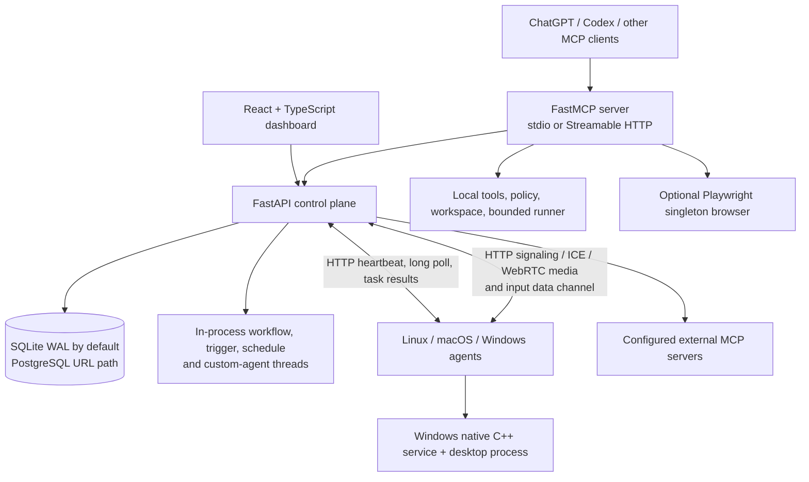

# ServerAI engineering audit

**Date:** 2026-11-14
**Scope:** Static review of the checked-out repository against the supplied Master Engineering Roadmap. No tests, load tests, deployment, or Windows runtime checks were run. Performance comments below are hypotheses from the code structure, not measurements.

## 1. Architecture observed in source

The actual stack is a Python modular monolith: FastAPI control plane, FastMCP server, SQLite or a PostgreSQL adapter, React/Vite dashboard, outbound HTTP polling agents, optional aiortc/WebRTC, optional Playwright, and a separate C++20 Windows agent. This is a sensible reuse-first foundation. The architecture diagram in `docs/architecture.md` describes the intended split, but several statements there should be treated as design intent until runtime/platform validation is complete.

## 2. Repository and dependency review

- Backend package is `src/ai_bridge`; entry points are `ai-bridge` and `ai-bridge-control` in `pyproject.toml`.
- HTTP API and most product behavior live in `src/ai_bridge/control/app.py`; custom agent loops are in `control/custom_agents.py`; MCP tools and routing live in `server.py`, `tools.py`, and `device_routing.py`.
- Agents share `agents/common/poller.py`; platform-specific implementations are under `agents/{linux,macos,windows}`. Native Windows service, capture, encoding, input and IPC code is under `windows-agent/`.
- Dashboard source is `apps/dashboard`; schema migrations are in `migrations/`; shared protocols and permission matrix are in `shared/`; deployments are in `deployment/` and the Docker Compose files.
- Declared key dependencies include FastAPI, Uvicorn, FastMCP, Pydantic, HTTPX, cryptography and psutil. aiortc/av and Playwright are optional extras. Redis is declared, but the inspected architecture and core state paths do not use it as a queue or shared state store. The PostgreSQL adapter imports `psycopg`, which is not declared in the inspected `pyproject.toml` or `requirements.txt`; verify/document an install extra before advertising PostgreSQL as turnkey.
- `docs/implementation-status.md`, `docs/ROADMAP.md`, `docs/architecture.md`, `docs/security.md` and `docs/production-readiness.md` have inconsistent status claims. For example, one status file says macOS code is absent while `agents/macos/agent_main.py` exists; it also describes Postgres wiring as absent while `control/db.py` has a connection adapter. The more accurate status is “code path exists, runtime / deployment proof is not established here.” Reconcile these docs before relying on them as release evidence.

## 3. Current capability inventory

| Area | Evidence in source | Status from this review |
|---|---|---|
| MCP integration | FastMCP stdio/Streamable HTTP in `src/ai_bridge/server.py`; integrations under `integrations/` | Implemented; HTTP live round-trip is explicitly not evidenced by the status doc |
| Control plane and fleet | `control/app.py`: enrollment, heartbeat, task submit/poll/result, revocation, policies, approvals, audit, fleet operations | Broad feature set exists; single-process and deployment constraints remain |
| Agents | Shared poller with heartbeat, long polling, token rotation and backoff; Linux, Windows and macOS entry points | Implemented paths; Windows/macOS execution needs native-host verification |
| Desktop and streaming | `webrtc_stream.py`, FastAPI WebRTC signaling/session routes, native DXGI/Media Foundation/SendInput components | Substantial implementation exists; no latency, reliability, or multi-monitor benchmark was found |
| Computer intelligence | Screenshot capture, OCR/UI element tools, screen verification and desktop actions in `tools.py` and desktop agent code | Useful primitives exist; no central GUI state model or generalized action planner was established |
| Agent runtime | `control/custom_agents.py`: provider integrations, bounded steps, tool policy, approvals, persistent memory, run history | A scheduled custom-agent loop exists; it is not the full named Supervisor/Planner/Researcher/Recovery multi-agent architecture in the roadmap |
| Browser | `browser_tools.py` implements Playwright navigation, screenshot, DOM interaction, download and JavaScript execution | Local browser automation exists; one module-level browser/context/page is shared, not isolated per user/session |
| Coding automation | Workspace tools, allowlisted test/lint operations, git operations and task execution | Useful building blocks; no complete repository-to-verified-change workflow or configured remote push agent was evidenced |
| Memory and recovery | SQLite tables for task/workflow/agent history; custom-agent memory; agent result spool; cancellation APIs | Partial persistence exists; no general resumable task checkpoint/dependency engine across process restarts |
| Device management | Enrollment, OS/hostname/status, CPU/RAM/disk telemetry, tasks, policy and dashboard | Useful fleet view; inventory does not yet prove every roadmap field (installed apps/tools, supported capabilities and active task details) is collected consistently |
| Security | Role auth, device tokens, policy tiers, approvals, audit redaction, path confinement, bounded process runner, optional net namespace, OIDC hooks | Meaningful controls exist; see high-priority validation and isolation gaps below |

## 4. Missing or incomplete roadmap capabilities

### P0: communication and performance

WebRTC, input data channels, ICE configuration, adaptive stream parameters, reconnection-related signaling and health telemetry exist in source. Persistent device transport currently centers on heartbeat plus HTTP long polling; the API also has event streaming, but no central bidirectional WebSocket device channel is evident. The roadmap’s frame-difference detection and measured latency/recovery targets are not verified. Multi-monitor code exists in native/UI paths; cross-platform and failure-mode behavior still needs runtime evidence.

### P0: computer intelligence

OCR, screen capture, UI element listing, visual action checks and desktop interaction are present. The repository does not establish robust application/window recognition feeding a persistent GUI state model, visual grounding accuracy, or automated recovery based on observed state. Treat these as partial capabilities pending workflow-level validation.

### P0: autonomous engine and safety

Custom agents run scheduled LLM loops with a bounded step count and tool allowlist, persistent agent memory and approval actions. This does not yet match a supervisor/planner/researcher/developer/tester/security/recovery ensemble sharing durable task context and dependencies. The bounded runner is not a general isolated code-execution service; its network namespace option applies only to that runner. Avoid conflating named agent roles in the roadmap with separately implemented runtimes.

### P1: browser and coding

Playwright Chromium tools are present; Browserbase, Firecrawl and You.com integrations were not found in manifests/source. Browser contexts are ephemeral and globally shared at module level, rather than separately isolated persistent profiles with multi-session ownership. Coding workflows have repository, test/lint and Git primitives but lack a durable end-to-end coding task lifecycle with test and visual verification evidence.

### P1: memory, device inventory and operations

Persistent DB history and custom-agent memory exist. General task checkpoint recovery and dependency tracking do not appear established. Device data covers common status and telemetry, but the requested inventory of installed apps/tools and explicit supported capabilities is not a consistent contract. Dashboard inventory has known limits documented in `docs/production-readiness.md` (full snapshots for selection; not million-device scalable).

### P0: security/reliability and production readiness

Security controls are real but not equivalent to a security certification. Documentation itself calls out in-process emergency-stop and OIDC pending state, one-worker deployment assumptions, incomplete tenant isolation review, and reverse-proxy rather than native plane mTLS. Clean production deployment and Windows-on-Windows execution are not proven by this checkout’s documentation.

## 5. Performance bottlenecks to measure

No performance target can be claimed met from static inspection. Recommended first measurement points:

1. **DB serialization:** SQLite uses one locked connection; the PostgreSQL adapter also serializes operations through one connection/lock. Long-poll waiters, audit writes, fleet reads and background jobs can contend. Measure API p50/p95/p99 under concurrent task polling and writes before considering a pool or queue.
2. **In-process concurrency:** workflow/schedule/custom-agent/task work uses threads and process-local locks. Work may compete with API operations, and replicas do not coordinate the locks or schedules. Measure queue delay, thread count, DB lock wait and task completion under 10+ independent tasks.
3. **Desktop pipeline:** capture, frame conversion, encoding, network transport and browser rendering each need stage timestamps. Measure frame rate, capture/encode/transport/render latency, CPU/GPU, dropped frames and reconnection under packet loss. Existing telemetry and adaptive parameters are not benchmark results.
4. **Fleet polling:** agents use heartbeat and long polling with backoff. Measure task dispatch latency and API resource use as devices and idle long-poll connections increase. Compare event stream/WebSocket options only after baseline results.
5. **Browser singleton:** synchronous Playwright calls and a shared browser page can serialize unrelated work and cause cross-session interference; measure only after ownership/isolation is fixed.

Proposed acceptance gates should be benchmarked, not copied blindly: API p95 under 100 ms on a documented deployment profile; command dispatch overhead under 150 ms excluding agent execution; reconnect p95 under 5 s; screenshot pipeline p95 under 500 ms at a specified resolution; 10+ independent tasks without lost/duplicated work; and explicit pass/fail verification for every supported workflow.

## 6. Security assessment (static, prioritized)

1. **High — shared browser state crosses callers.** `browser_tools.py` holds module-global `_browser`, `_context` and `_page`; there is no session/user owner or concurrency lock. Cookies, local storage and current page can be shared between MCP callers, and concurrent operations can target the wrong page. Make browser sessions explicitly owned and isolated before exposing multi-user browser automation.
2. **High — custom browser URLs and JS execution expand network/credential exposure.** Browser navigation accepts caller-provided URLs and the tool set includes page JavaScript evaluation. A browser with access to private network endpoints or authenticated pages can be steered to sensitive resources. Enforce destination policy (including redirects, DNS/IP ranges and downloads), isolate the browser process/network, and scope evaluation to authorized sessions.
3. **High — process-local emergency stop/scheduler state limits multi-worker safety.** Production-readiness docs say emergency stop and OIDC pending state are in process memory and require one worker; scheduler threads and local locks also do not coordinate replicas. Enforce a single-worker deployment mechanically or move coordination/locks/state to a durable shared backend before horizontal scaling.
4. **High — sandbox coverage is narrower than the product surface.** `execution.py` explicitly limits its sandbox to the bounded task runner, while the MCP codebase has other execution paths and host tools. Confirm every exposed operation is policy-gated and confined; keep `AI_BRIDGE_DISABLE_HOST_TOOLS=1` as the default and audit tools against that invariant.
5. **Medium — credentials and database protection.** The DB schema stores MCP auth tokens and OAuth secrets in DB fields; ensure production DB, backups, exports, and admin access are encrypted and restricted, and prefer a secret manager/envelope encryption for connector credentials. SQLite DB is sensitive operational data.
6. **Medium — docs are security-sensitive configuration.** Several status/security statements are stale or contradictory. Update documented defaults and verified platform boundaries so operators do not mistake optional proxy mTLS, local-only controls, or code presence for enforced production guarantees.

Positive controls found: role-based auth and session revocation, hashed device token storage and expiry, server-side tier/policy checks, human approvals, redacted audit records, workspace confinement, argument-array subprocess calls and task timeouts/cancellation. These controls need end-to-end testing on each supported deployment, especially multi-tenant and multi-worker modes.

## 7. Quality and maintainability

- Strengths: clear Python package layout; explicit migration files; shared agent poller; tests separated into unit/integration/e2e/security; architecture and operations documentation; policy and audit primitives are reused across several features.
- Risks: `control/app.py` is a very large module with API routes, state, scheduler behavior, SSE, workflow and desktop handlers; extract cohesive routers/services while preserving route tests/contracts.
- The SQLite/PostgreSQL compatibility layer and migration adaptation need live Postgres integration coverage before Postgres can be a production claim. Add/declare psycopg packaging.
- Multiple generations of dashboard and agent code coexist; clarify canonical paths and remove stale or generated release artifacts from source control as a separate repository hygiene pass.
- Centralize observable task/session state and typed event schemas. Keep browser page and WebRTC session ownership explicit.
- Keep dependency pins/lock behavior reproducible across root Python package, native Windows build, and dashboard; establish supported-version matrices.

## 8. Recommended architecture

Retain the current stack and modular-monolith deployment for now. It matches the source and avoids a costly rewrite before measurement. Preserve FastAPI + FastMCP, React/TypeScript, existing agents and native Windows capture/input, and the current DB abstraction. Define stable internal interfaces around: (1) durable task/state store, (2) device connection/session manager, (3) policy/authorization, (4) execution adapters, (5) event/audit stream, and (6) verification results.

For an initial single-node deployment, SQLite is appropriate if its concurrency and recovery limits match the target. For multi-instance availability, complete PostgreSQL support with a tested connection pool and move scheduling, emergency-stop, OIDC state and task coordination out of process memory. Adopt Redis or a durable queue only when measured dispatch load or cross-instance coordination requires it. Do not add gRPC or replace HTTP/WebRTC until latency and scale measurements identify a need.

## 9. Exact implementation roadmap

| Phase | Work and completion evidence | Priority |
|---|---|---|
| 0. Baseline and truth | Reconcile capability docs; identify supported deployment profiles; run existing checks in CI; record Python/API/dashboard/platform matrix; instrument baseline latency and queue metrics | Critical, first |
| 1. Ownership and safety | Isolate browser sessions by principal; add destination/download restrictions; trace tool permissions; add Windows/macOS end-to-end host validation; document enforced vs optional security | Critical |
| 2. Communication and desktop reliability | Instrument capture-to-render stages; test reconnect, network loss, key release, multi-monitor and frame pacing; standardize health/session lifecycle; add a persistent bidirectional channel only if baseline proves long-poll limits | Critical |
| 3. Durable task orchestration | Define task state machine, idempotency, cancellation and checkpoint schema; persist events; reconcile on restart; guarantee single scheduler ownership or use shared leases | Critical |
| 4. Agent runtime | Build named responsibilities as bounded capabilities around shared task context; add dependency graph, budget/step limits and recovery; preserve approval/policy checks at every tool dispatch | Critical |
| 5. Browser and coding workflows | Per-session Playwright contexts; reusable reviewed workflow lifecycle; repo inspection/change/test/lint/visual/security verification; optional external browser/search integrations only when required | High |
| 6. Memory and inventory | Durable project/task memory with provenance/retention; schema for app/tool capabilities and active tasks; report CPU/RAM/disk/processes/apps and connection health consistently | High |
| 7. Scale and production security | PostgreSQL integration tests and pooling; shared state/leases; secret encryption and backup drills; tenant-isolation review; deployment hardening and observability | Critical |
| 8. Acceptance and release | Load test 10+ independent tasks; verify target latency/recovery; workflow-level verification coverage; clean install/deploy/recovery drills on supported platforms | Critical |

## 10. File-by-file modification plan

1. `docs/implementation-status.md`, `docs/ROADMAP.md`, `docs/architecture.md`, `docs/security.md`, `docs/production-readiness.md`: reconcile code-present vs runtime-verified claims and make one canonical capability matrix.
2. `src/ai_bridge/browser_tools.py`, `src/ai_bridge/server.py`, `src/ai_bridge/control/app.py`: replace module-global browser state with an owned session manager; enforce destination policy; authorize lifecycle and evaluation per session.
3. `src/ai_bridge/control/app.py`, `src/ai_bridge/control/custom_agents.py`, `src/ai_bridge/control/db.py`: extract routers/services; persist/coordinate emergency stop, OIDC state, leases and scheduler ownership; add task checkpoint/event schema and restart recovery.
4. `src/ai_bridge/webrtc_stream.py`, `src/ai_bridge/control/app.py`, `agents/common/poller.py`, `windows-agent/src/`: add stage-level metrics and test reconnect/key release/multi-monitor behavior; decide transport changes from measured results.
5. `src/ai_bridge/control/db.py`, `src/ai_bridge/control/migrations.py`, `migrations/`, `pyproject.toml`, `requirements.txt`: declare PostgreSQL driver extra; add pool and real PostgreSQL migration/API test coverage before production support claims.
6. `agents/common/poller.py`, `agents/linux/agent_main.py`, `agents/macos/agent_main.py`, `agents/windows/agent_main.py`, `windows-agent/`: define a versioned capability/inventory schema and test parity per platform.
7. `src/ai_bridge/control/custom_agents.py`, `src/ai_bridge/control/db.py`, `migrations/`, `apps/dashboard/src/`: implement task dependency/checkpoint and provenance-backed memory model; surface durable status and recovery.
8. `apps/dashboard/src/`, `apps/dashboard/e2e/`, `tests/`: provide isolated browser/session UX and end-to-end lifecycle coverage; add measurable verification gates.
9. `deployment/`, `docker-compose*.yml`, `.github/workflows/ci.yml`: codify supported single-worker or clustered profile, health metrics, secrets, backups and deployment checks.

### Overall conclusion

The repository is a substantial, security-conscious remote computer-control and fleet-operations platform with working implementation paths across MCP, agents, dashboard, desktop streaming, browser tools and scheduled custom agents. It is not yet evidenced as the complete autonomous multi-agent engineering platform or as meeting the proposed latency, scale, verification and cross-platform targets. The best next step is a source/status truth pass plus browser isolation and runtime baseline measurements, followed by reliability and durable orchestration work. No wholesale stack replacement is justified by the inspected source.
